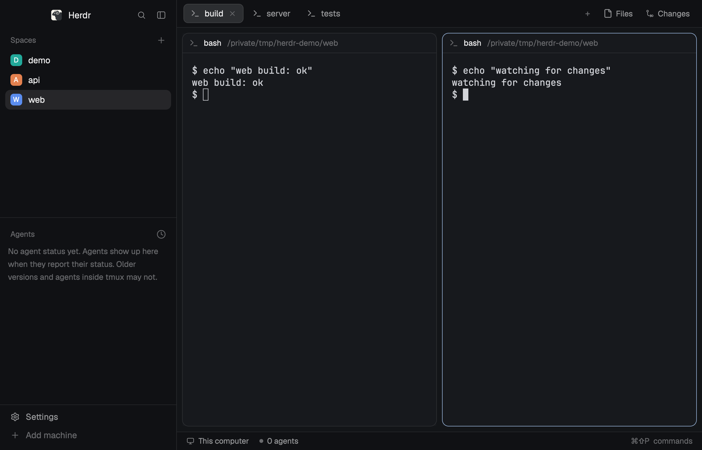
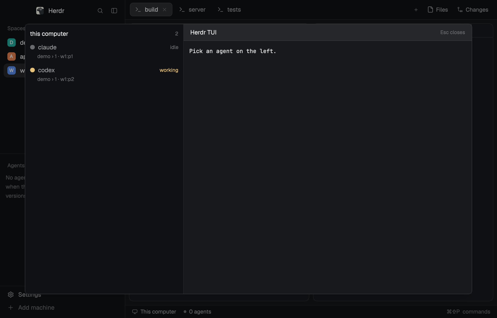
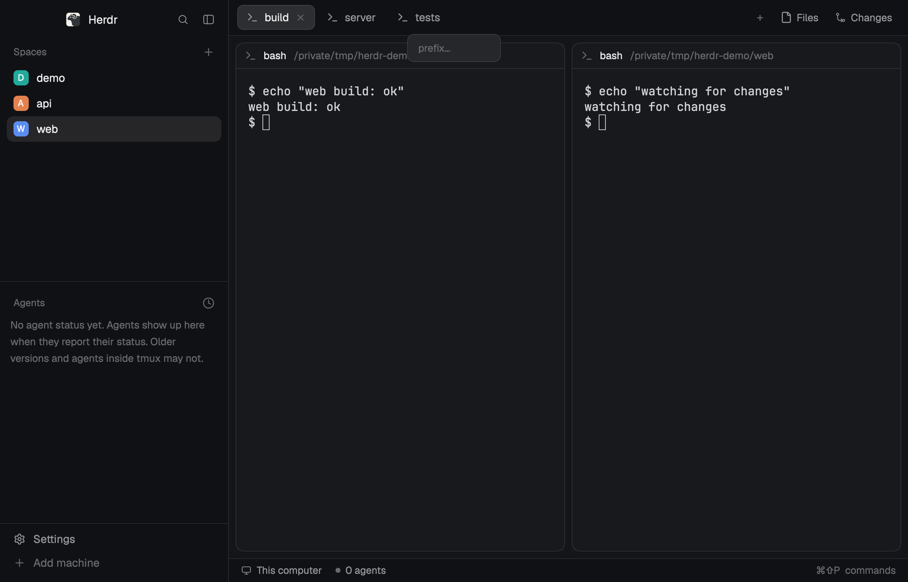
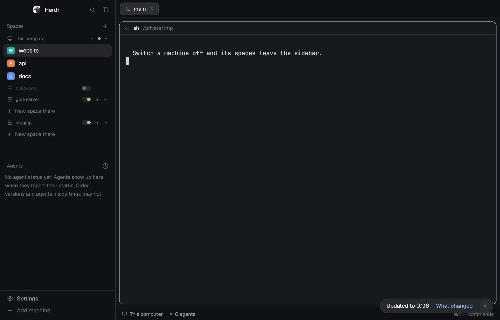

# Herdr Mods

Four mods for the [Herdr](https://herdr.dev) desktop app. Each folder is one entry in the Herdr mod gallery, laid out like an app home. Each has its own `README.md`, a `RECIPE.md` for an agent that builds or adds it, and a `preview.png`.

To add one, ask your Herdr agent:

```text
Read ~/.config/herdr-app/AGENTS.md, then add this mod: herdr.dev/mods/Dot-Fun/herdr-mods/<entry>
```

Put `tab-drag`, `tui-bridge`, `prefix-keys` or `machine-switch` in place of `<entry>`. Each entry works alone.

## Tab Drag

Drag a tab along the tab bar to put it in a new place. Drag a tab onto the pane area to split the shown tab with it. Drag a pane by its header up to the tab bar to give it its own tab. It comes with a layout, `main-dnd`, which is Herdr's `main` layout with the new tab bar and pane headers.



[Read more](tab-drag/README.md)

## TUI Bridge

See and prompt the agents that still run in the herdr terminal app (the TUI), on this computer and on every machine saved in `herdr machine list`. Pick an agent to read its screen, and press Enter to send it a prompt.



[Read more](tui-bridge/README.md)

## Prefix Keys

A `ctrl-b` prefix, as in tmux. Press `ctrl-b`, then one key to split, move, zoom or close panes, switch tabs, send a pane to another space, or open a second window.



[Read more](prefix-keys/README.md)

## Machine Switch

A switch on each machine's row in the Spaces sidebar. Switch a machine off and its spaces fold away. The machine stays in the list, drawn dim, and one click brings it back. Drag a machine to change the order. Every Herdr window on the computer follows.



[Read more](machine-switch/README.md)

## License

Apache License 2.0. See [LICENSE](LICENSE). `tabs-dnd`, `pane-dnd` and `spaces-machines` are changed copies of mods that ship with Herdr. See [NOTICE](NOTICE).
