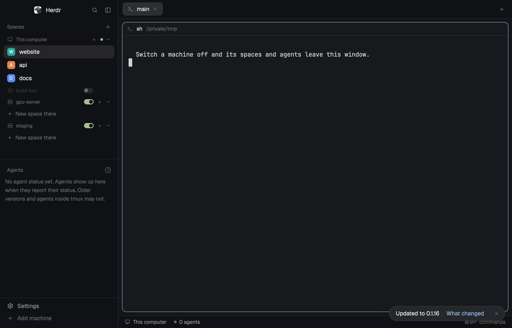

# Machine Switch

A switch on each machine's row in the Spaces sidebar of the [Herdr](https://herdr.dev) desktop app. Switch a machine off and its spaces fold away in this window. The machine stays in the list, drawn dim, and one click on the switch brings it back.



The preview shows three example machines. `build-box` is off: its row is dim and its switch is grey. `gpu-server` and `staging` are on.

Use it when you have many machines and want one window to show only some of them. Nothing is disconnected. A machine that is off stays connected, and its terminals and agents keep running.

The entry has one mod, `mods/spaces-machines`. It is a changed copy of Herdr's `spaces` mod.

**Before you add it:** the mod runs the same programs as Herdr's `spaces` mod: `hc` (herdr-core) to list machines, and `git` to read each space's branch. It does not use the network.

## Add it

Ask your Herdr agent:

```text
Read ~/.config/herdr-app/AGENTS.md, then add this mod: herdr.dev/mods/Dot-Fun/herdr-mods/machine-switch
```

To add it by hand:

1. Clone the repository: `git clone https://github.com/Dot-Fun/herdr-mods.git`.
2. Copy the mod: `cp -R herdr-mods/machine-switch/mods/spaces-machines ~/.config/herdr-app/mods/`.
3. Herdr's own layouts are read-only. If you use one, clone it first: `herdr-app do layout.clone '{"name":"main","as":"my-main"}'`.
4. In your layout file, change the sidebar block's `"mod": "spaces"` to `"mod": "spaces-machines"`.
5. Check the mod: `herdr-app check ~/.config/herdr-app/mods/spaces-machines`.

## Use it

| Where | What to do |
| --- | --- |
| Wide sidebar | Click the switch on a machine's row. It sits between the machine's name and its `+`. |
| Narrow sidebar (the icon rail) | Right-click the machine's icon. |

"This computer" has no switch. It always shows.

Each window keeps its own set of machines that are off. One window can show your own machines and a second window the rest.

## Hide the machine's agents too

The mod stores the names of the machines that are off in shared state, under the key `machines.hidden`. Any mod can read it. The sidebar's spaces list reads it. Herdr's `agents` mod does not, so agents on a machine that is off still show in the Agents list.

To hide them, clone the mod that lists your agents and filter its list. An agent on another machine has an address such as `build-box/t7`.

```js
const off = shared("machines.hidden") ?? [];
const list = agents().filter(a => !off.includes(a.address.split("/").slice(0, -1)[0]));
```

With no `machines.hidden` value, nothing is hidden. The filter is safe in a mod that runs without Machine Switch.

## Known limits

- The status bar still counts the agents of every machine.
- Keys that switch spaces, such as next space and previous space, still reach spaces on a machine that is off.
- Herdr's own sound and toast for an agent that needs you still come from a machine that is off.
- The green status dot on remote machine rows is gone. The switch sits in its place. A machine that is not connected still shows its state as text.
- The mod is a copy of `spaces` from Herdr 0.1.16. It does not get Herdr's later changes to `spaces`.

## License

Apache License 2.0. See [LICENSE](../LICENSE). `spaces-machines` is a changed copy of a mod that ships with Herdr. See [NOTICE](../NOTICE).
