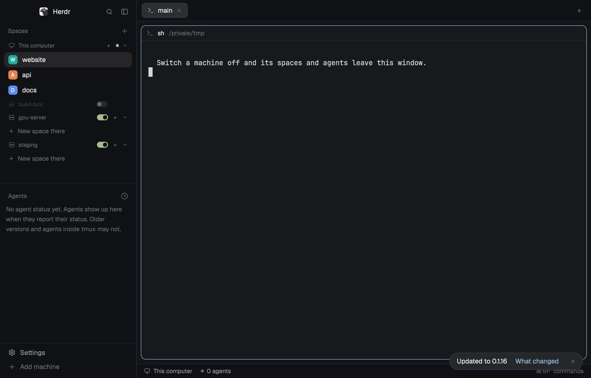

# Machine Switch

Herdr's Spaces sidebar with an on/off switch on each remote machine's row. A machine that is off stays in the list, drawn dim, without its spaces.

## What you see

The sidebar looks the same as Herdr's `spaces` mod at app version 0.1.16, with these changes to a remote machine's header row (26px high, 8px side padding, 7px gap, 11px `dim` text):

- **On**: server icon 13px, the machine's name, its state text when not connected, the switch, the `+` button when connected, the fold chevron 11px. There is no status dot. "This computer" keeps its dot and has no switch.
- **The switch**: 22 x 12px, 6px corners. On: `ansi2` track, an 8px `chrome` knob at left 12, top 2. Off: `border` track, an 8px `dim` knob at left 2, top 2. Tooltip `Hide <name> in this window` when on, `Show <name>` when off.
- **Off**: icon and name at 0.45 opacity, then the switch, then a 33px spacer so the switch stays in the same column as on rows. No `+`, no chevron, no state text, no hover fill. No rows under it: no spaces, no "Loading…", no "New space there", no login note.
- **Narrow rail** (sidebar under 160px): a machine that is off shows its icon at 0.45 opacity, with the tooltip `<name> · hidden. Right-click to show.`

## How it behaves

- **A click on the switch** adds the machine's name to shared `machines.hidden`, or removes it. The click stops propagation, so it does not fold the group.
- **A click on the header of a machine that is off** does nothing.
- **Narrow rail**: a right-click on a remote machine's icon flips the same value. There is no switch there.
- **Spaces**: rows of a machine in `machines.hidden` are filtered out before drawing. The machine's name stays in the list of remote machines, also when the core no longer lists it, so it can be switched back on.
- **Shared state is per window.** Each app home has its own `machines.hidden`.
- Agent status, drag to reorder, git tails, fold state and the reconnect flow are Herdr's and unchanged.

## Built from

- **`mods/spaces-machines`**: a clone of `spaces` (`herdr-app do mod.clone '{"name":"spaces","as":"spaces-machines"}'`). All changes are in `grouped()`.
- **Layout**: the sidebar block's `content.mod` is `spaces-machines`.
- **herdr functions added to the clone's use**: `shared("machines.hidden")`, `setShared("machines.hidden", names)`.
- **Programs**: as in `spaces`: `hc machine ls --json`, `git`.
- **Art**: the shipped `mods/workspace-chrome/server.svg`, `monitor.svg`, `chevron-*.svg`, `plus.svg`.

## Watch out

- Return early for a machine that is off, and add 1 to the running count of drawn children first. The list scrolls to the active space by child index.
- Put `machines.hidden` names into the remote list. A hidden machine that the core forgot would have no row and no way back.
- Other mods do not follow by themselves. A mod cannot change what `agents()` or `spaces()` return to other mods. An agents list must filter on `machines.hidden` itself: `a.address.split("/").slice(0, -1)[0]` is the agent's machine, `undefined` for this computer.
- A popup is a poor fit for this control. It takes its size from its first draw, and a list that loads after that stays one line tall.
- Shipped layouts are read-only. Point a cloned layout at the mod.

## Done when

- `herdr-app check mods/spaces-machines` passes and `herdr-app status` shows `errors: []`.
- With `machines.hidden` set to one machine's name, that machine's row is dim with a grey switch, no rows show under it, and the other machines look as before.
- A click on the switch brings the machine's spaces back.
- "This computer" has no switch.
