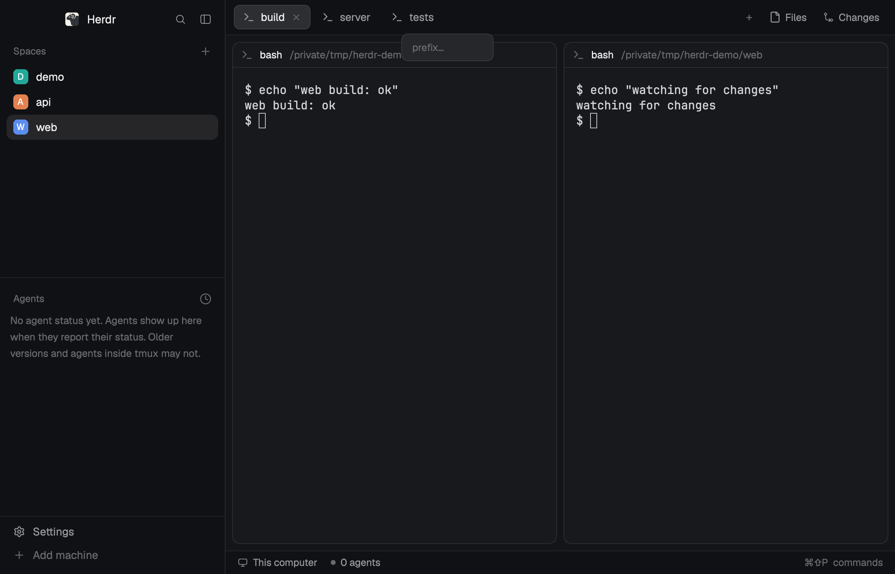

# Prefix Keys

A tmux-style `ctrl-b` prefix for the [Herdr](https://herdr.dev) desktop app. Press `ctrl-b`, then one key. The key splits, moves, zooms or closes panes, switches tabs, sends a pane to another space, or opens a second window.



The preview shows the small `prefix…` popup at the top of the window. It waits for the next key.

The entry has:

- `mods/prefix`: the popup that reads the key after `ctrl-b`.
- `mods/send-to-space`: the list that `ctrl-b m` opens.
- `keys.json`: the binding `"ctrl-b": "mod.open:prefix"` in the `global` section, and two optional close keys for macOS (see Close keys).
- `bin/herdr-window`: the script that `ctrl-b w` runs.

**Before you add it:** `prefix` runs `hc` (herdr-core) to press `ctrl-b` in a terminal and to set terminal labels. It runs `~/.local/bin/herdr-window` for `ctrl-b w`. `send-to-space` runs `hc` to set terminal labels. Neither mod uses the network. `herdr-window` reads and copies files from `~/.config/herdr-app` into a new app home.

## Add it

Ask your Herdr agent:

```text
Read ~/.config/herdr-app/AGENTS.md, then add this mod: herdr.dev/mods/Dot-Fun/herdr-mods/prefix-keys
```

To add it by hand:

1. Clone the repository: `git clone https://github.com/Dot-Fun/herdr-mods.git`.
2. Copy the mods: `cp -R herdr-mods/prefix-keys/mods/* ~/.config/herdr-app/mods/`.
3. Open `~/.config/herdr-app/keys.json` and add `"ctrl-b": "mod.open:prefix"` to its `global` section. Do not replace the whole file with this entry's `keys.json`. A keys file holds every key you have.
4. For `ctrl-b w`, copy the script: `cp herdr-mods/prefix-keys/bin/herdr-window ~/.local/bin/` and make sure it can run: `chmod +x ~/.local/bin/herdr-window`.
5. Check each mod: `herdr-app check ~/.config/herdr-app/mods/prefix` and `herdr-app check ~/.config/herdr-app/mods/send-to-space`.

## Keys

Press `ctrl-b`, let go, then press one of these keys. Pane and tab keys act on the pane that had focus before `ctrl-b`.

| Key | What it does |
| --- | --- |
| `c` | New tab |
| `v` | Split the pane right |
| `-` | Split the pane down |
| `h` `j` `k` `l` | Focus the pane left, down, up or right |
| `H` `J` `K` `L` | Swap the pane with the one left, down, up or right |
| `z` | Zoom the pane, or unzoom it |
| `x` | Close the pane |
| `!` | Move the pane out to a new tab in the same space |
| `m` | Send the pane to another space on the same machine, as a new tab |
| `n` / `p` | Next tab / previous tab |
| `1` to `9` | Show tab 1 to 9 |
| `T` | Rename the tab |
| `X` | Close the tab |
| `N` | New space |
| `W` | Rename the space |
| `D` | Close the space |
| `<` / `>` | Move the space up or down one place among the spaces of its machine |
| `g` | Open Herdr's picker |
| `t` | Open the [tui-bridge](../tui-bridge/README.md) panel (needs that mod) |
| `b` | Show or hide the sidebar |
| `?` | Open Herdr's help |
| `w` | Open a second Herdr window (needs `herdr-window`) |
| `ctrl-b` | Send `ctrl-b` to the program in the terminal |
| Escape, or any other key | Close the popup and do nothing |

In the `ctrl-b m` list, press up and down (or `j` and `k`) to choose a space, Enter to send, and Escape to cancel.

## The `w` key and `herdr-window`

`herdr-window` opens one more Herdr window that shows the same terminals. It does this:

1. It finds the first app home, `~/.config/herdr-app-2`, `-3` and so on, whose window does not answer `herdr-app status` within 3 seconds.
2. It copies `keys.json`, `settings.json` and `programs.json` from `~/.config/herdr-app` into that home. It copies `shared.json` only when it makes the home.
3. It copies the layout `main-dnd.json` and the mods `prefix`, `herdr-tui`, `send-to-space`, `tabs-dnd`, `tab-drop` and `pane-dnd`. Some of these come from the other entries in this repository. When one is missing, `rsync` prints an error and the script goes on.
4. It starts the app with `open -n -a ~/Applications/Herdr.app` and the new `HERDR_APP_HOME`.

Edit `~/.config/herdr-app` only. Each launch writes over the copies in the second home.

## Known limits

- `ctrl-b` no longer reaches programs in the terminal, such as tmux, readline or an editor. Press `ctrl-b ctrl-b` to send it.
- The `w` key needs `herdr-window` at `~/.local/bin/herdr-window`. The script works only on macOS (`open -n`), and it expects the app at `~/Applications/Herdr.app`. If your app is in `/Applications`, change that path in the script.
- `!` and `m` move a pane by parking its terminal and setting its `herdr.space` and `herdr.tab` labels with `hc label`. They wait up to 3 seconds for the pane to go first.
- `m` lists only spaces on the same machine as the pane.
- `!` does nothing for a pane that is alone in its tab.
- The popup shows only `prefix…`. It does not list the keys.

## Close keys

The entry's `keys.json` also swaps the two close keys on macOS. They are optional, and the mods work without them.

| Key | Herdr default | With this entry |
| --- | --- | --- |
| `cmd-w` | Close the tab and every pane in it | Close the focused pane only |
| `cmd-shift-w` | Close the focused pane | Close the tab |

A split tab then loses one pane per `cmd-w`, not all of them. To use them, add `"cmd-w": "pane.close"` and `"cmd-shift-w": "tab.close"` to the `global` section of your `keys.json`.

## License

Apache License 2.0. See [LICENSE](../LICENSE).
