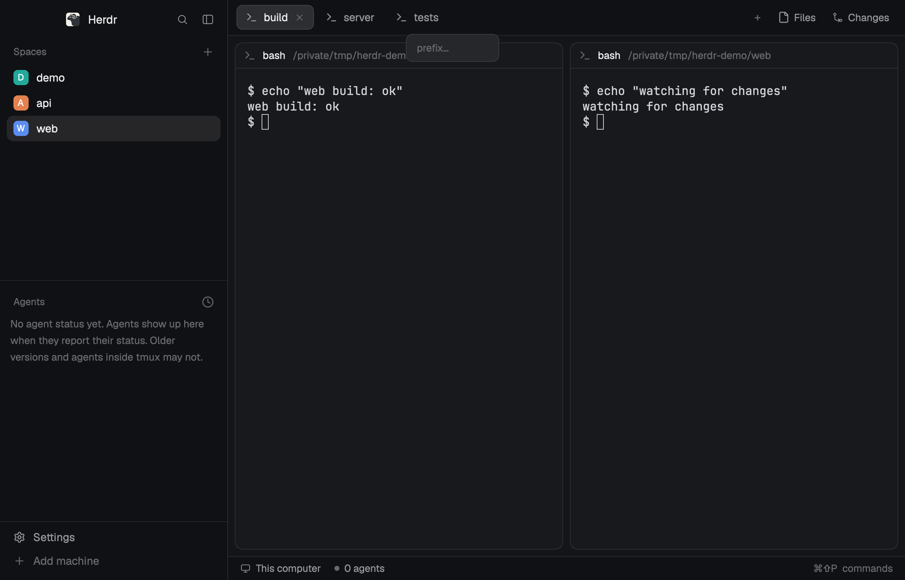

# Prefix Keys

A `ctrl-b` prefix, as in tmux. `ctrl-b` opens a small popup at the top of the window. The next key runs one command on the pane, tab or space that had focus before, and the popup closes.

## What you see

- **Prefix popup**: a popup at the top, 40px down, 110px wide, with no frame. Inside: `prefix…` in 12px `dim`, 12px side and 6px top and bottom padding, 8px corners, a 1px `border` outline, `popover` fill.
- **Send to space** (`ctrl-b m`): a popup at the top, 40px down, 320px wide, half the window high. 12px padding, 4px gap, `popover` fill, 13px `foreground` text. A heading `Send pane to…` in 11px `dim`. Then one 30px row per target space, 10px side padding, 7px corners, with the space name. The chosen row has `hover` fill. With no target, one `dim` row: `no other space on this machine`.

## How it behaves

- **Opening**: `keys.json` binds `ctrl-b` to `mod.open:prefix` in `global`. The popup saves `focused()` (pane, tab, space, terminal) before it takes the keyboard. It focuses itself at once and again after 300ms.
- **A key**: a lone modifier (`shift`, `control`, `alt`, `meta`, `cmd`, `platform`) is ignored. Any other key closes the popup first. The one exception is `!` when it can move the pane: the popup stays open until the move ends.
- **`ctrl-b` again**: runs `hc keys <terminal> ctrl+b` on the saved terminal.
- **Other chords**: any other key with `control`, `alt` or `platform` does nothing.
- **Command keys** (from the `KEYS` table):

  | Key | Command |
  | --- | --- |
  | `c` | `tab.new` |
  | `v` / `-` | `pane.split {direction: "right"}` / `{direction: "down"}` |
  | `h` `j` `k` `l` | `pane.go {direction}` left, down, up, right |
  | `H` `J` `K` `L` | `pane.swap {direction}` left, down, up, right |
  | `z` / `x` | `pane.zoom` / `pane.close` |
  | `n` / `p` | `tab.next` / `tab.prev` |
  | `1` to `9` | `tab.select {index}` |
  | `T` / `X` | `tab.rename {id}` / `tab.close {id}` with the saved tab |
  | `N` | `space.new` |
  | `W` / `D` | `space.rename {id}` / `space.close {id}` with the saved space |
  | `g` / `t` | `mod.open {name: "picker"}` / `{name: "herdr-tui"}` |
  | `b` | `layout.toggle {id: "sidebar"}` |
  | `?` | `app.help` |

  `pane.split`, `pane.swap`, `pane.zoom` and `pane.close` get `pane` set to the saved pane.
- **`!`**: only when the saved terminal exists and its tab has two or more panes. It runs `terminal.park`, polls `panes()` every 50ms for up to 60 tries until the terminal has no pane, then runs `hc label <terminal> herdr.space=<last part of the space id> herdr.tab=tbout<time in base 36>`. An unknown tab id makes a new tab. Then the popup closes.
- **`m`**: needs a saved terminal. It writes shared `send-to-space` as `{ terminal, space, machine }` and runs `mod.open {name: "send-to-space"}`. `mod.open` takes no props, so shared state carries the pane.
- **Send to space**: lists `spaces()` with the same `machine` as the pane, minus the pane's own space. Down or `j` and up or `k` move the choice and wrap around. Enter parks the terminal, waits the same way as `!`, runs `hc label <terminal> herdr.space=<last part of target id> herdr.tab=tbsent<time in base 36>`, then closes. Escape closes.
- **`<` and `>`**: find the spaces with the same `machine` as the saved space. The space before or after it in that group is the neighbor. Run `space.move {id, index}` with the neighbor's one-based place in the whole `spaces()` list.
- **`w`**: runs `exec("<home>/.local/bin/herdr-window")`.
- `herdr-window` (zsh): picks `~/.config/herdr-app-<n>` from n = 2, the first home whose `herdr-app status` does not answer within 3 seconds (`perl -e 'alarm 3; exec @ARGV'`). It copies `shared.json` once, `keys.json`, `settings.json`, `programs.json`, `layouts/main-dnd.json` and the mods `prefix`, `herdr-tui`, `send-to-space`, `tabs-dnd`, `tab-drop`, `pane-dnd` with `rsync -a`. Then it runs `env -u HC_TERMINAL_ID -u HC_TERMINAL_SOCKET -u HC_SCOPE open -n -a ~/Applications/Herdr.app --env HERDR_APP_HOME=<home>`. The new window uses the same herdr-core session.

## Built from

- **`mods/prefix`**: `mod.json` `{ "place": "none", "title": "Prefix", "overlay": { "kind": "popup", "at": "top", "offset": 40, "width": 110, "frame": "none" } }`. A focus handle with `track_focus` and `on_key_down`.
- **`mods/send-to-space`**: `mod.json` `{ "place": "none", "title": "Send to space", "overlay": { "kind": "popup", "at": "top", "offset": 40, "width": 320, "height": 0.5 } }`.
- **`keys.json`**: `{ "global": { "ctrl-b": "mod.open:prefix" } }`.
- **`bin/herdr-window`**: zsh script, uses `perl`, `rsync` and `open`.
- **herdr functions**: `run`, `focused`, `props`, `closeOverlay`, `theme`, `hc`, `panes`, `spaces`, `shared`, `setShared`, `exec`, `home`.
- **Programs**: `hc keys`, `hc label`, `herdr-window`.
- **Shipped mods used**: `picker`. `t` opens `herdr-tui` from the tui-bridge entry.
- No art.

## Watch out

- Save `focused()` in `init()`. Once the popup has the keyboard, `focused()` no longer gives the pane.
- Close the popup before running the command, except for `!`. A closed popup can stop its own task, so `!` closes only after the label lands.
- Relabeling a terminal that still has a pane does nothing. Park it, then wait for its pane to go.
- Labels use the machine's own ids: the last part after `/` of the space id.
- `ctrl-b` in `global` takes the key from every terminal. Programs get it only through `ctrl-b ctrl-b`.
- `w` assumes macOS, `~/.local/bin/herdr-window`, and the app at `~/Applications/Herdr.app`.
- Merge `keys.json` into the person's file. Replacing it drops their keys.

## Done when

- `herdr-app check` passes for `mods/prefix` and `mods/send-to-space`.
- `herdr-app do mod.open --name prefix` shows the `prefix…` popup, and `herdr-app status` lists it in `overlays`.
- `ctrl-b v` splits the focused pane right. `ctrl-b z` zooms it. `ctrl-b 2` shows tab 2.
- `ctrl-b !` in a tab with two panes makes a new tab with that pane, and the old tab keeps one pane.
- `ctrl-b m` lists the other spaces on the pane's machine, and Enter moves the pane there as a new tab.
- `ctrl-b ctrl-b` in a shell inside tmux reaches tmux as its prefix.
- `ctrl-b w` opens a second window that lists the same spaces.
