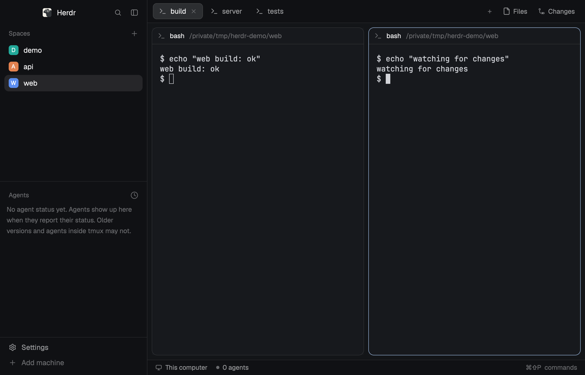

# Tab Drag

Drag tabs and panes in the [Herdr](https://herdr.dev) desktop app. Drag a tab along the tab bar to put it in a new place. Drag a tab down onto the pane area to split the shown tab with it. Drag a pane up to the tab bar to give it a tab of its own.



The entry has a layout and three mods:

- `layouts/main-dnd.json`: Herdr's own `main` layout (app version 0.1.16) with the tab bar set to `tabs-dnd` and the pane headers set to `pane-dnd`.
- `mods/tabs-dnd`: a copy of Herdr's `tabs` mod with tab drag added.
- `mods/pane-dnd`: a copy of Herdr's `pane` header mod with header drag added.
- `mods/tab-drop`: the drop zones that cover the window while you drag.

The mods run no programs, read no files and use no network. They only run Herdr commands.

## Add it

Ask your Herdr agent:

```text
Read ~/.config/herdr-app/AGENTS.md, then add this mod: herdr.dev/mods/Dot-Fun/herdr-mods/tab-drag
```

To add it by hand:

1. Clone the repository: `git clone https://github.com/Dot-Fun/herdr-mods.git`.
2. Copy the three mod folders: `cp -R herdr-mods/tab-drag/mods/* ~/.config/herdr-app/mods/`.
3. Copy the layout: `cp herdr-mods/tab-drag/layouts/main-dnd.json ~/.config/herdr-app/layouts/`.
4. Check each mod: `herdr-app check ~/.config/herdr-app/mods/tabs-dnd`, then the same for `tab-drop` and `pane-dnd`.
5. Show the layout: `herdr-app do layout.switch --name main-dnd`.

`ctrl-shift-l` switches back to your old layout. To remove the entry, delete the layout file and the three mod folders.

### In a layout of your own

1. Set the tab bar block to `{ "mod": "tabs-dnd" }`.
2. Set the pane header to `"header": { "content": { "mod": "pane-dnd" } }` in the block that shows the active tab.
3. Leave `tab-drop` out of the layout. The other two mods open it when a drag starts.

Keep the three folder names. The code names `tabs-dnd`, `pane-dnd` and `tab-drop` in several places.

## Gestures

| Gesture | Where you let go | What happens |
| --- | --- | --- |
| Press a tab and move along the bar | Another tab | The tab moves to that place. A 2px line shows where it lands, and the dragged tab fades. |
| Press a tab and move off the bar | The pane area | The tab's terminal splits the shown tab. The half nearest the pointer lights up. |
| Press a tab, move off the bar and come back | The tab bar | The drag goes on as a reorder. |
| Press a pane header and move off it | The tab bar | The pane leaves its tab and gets a new tab. The tab bar lights up. |
| Press the app's own grip at the top of a pane | The tab bar | The focused pane gets a new tab. See Known limits. |
| Any drag | Anywhere else | Nothing changes. |

Click, double-click and right-click on tabs work as in Herdr's own tab bar. So do the pane header buttons: split right, split down, zoom and close.

### Where the split goes

The pane area has four drop zones: left, right, top and bottom. The zone is the edge of the whole pane area nearest the pointer. The new pane goes beside the pane that has focus in the shown tab, not beside the pane under the pointer:

- Right or bottom: the new pane goes right of, or under, the focused pane.
- Left or top: the new pane goes right of, or under, the focused pane, and then swaps places with it.

Only one terminal moves: the dragged tab's focused pane, or its first pane. Other panes in the dragged tab stay where they are. A drop of the shown tab onto itself does nothing.

## Known limits

- **Grip drop on the tab bar.** The app does not tell mods which pane its grip carries. So the tab bar moves the focused pane. A text selection that you let go over the tab bar also triggers it. No highlight shows during a grip drag. The header drag has none of these faults, so use the header when you can.
- **Clones of shipped mods.** `tabs-dnd` and `pane-dnd` are copies of Herdr's `tabs` and `pane` mods at app version 0.1.16 (see `cloned_from` in each `mod.json`). The layout is a copy of `main` at 0.1.16. They do not get the changes that later app versions make to `tabs`, `pane` and `main`.
- **A pane alone in its tab** cannot be dragged out to a new tab. It already has one.
- **A move must finish within 5 seconds.** The tab bar finishes each move one step at a time. It drops a move that takes longer.
- The mods use art from Herdr's shipped `pane`, `workspace-chrome`, `files` and `changes` mods. Those ship with the app.

## License

Apache License 2.0. See [LICENSE](../LICENSE) and [NOTICE](../NOTICE).
