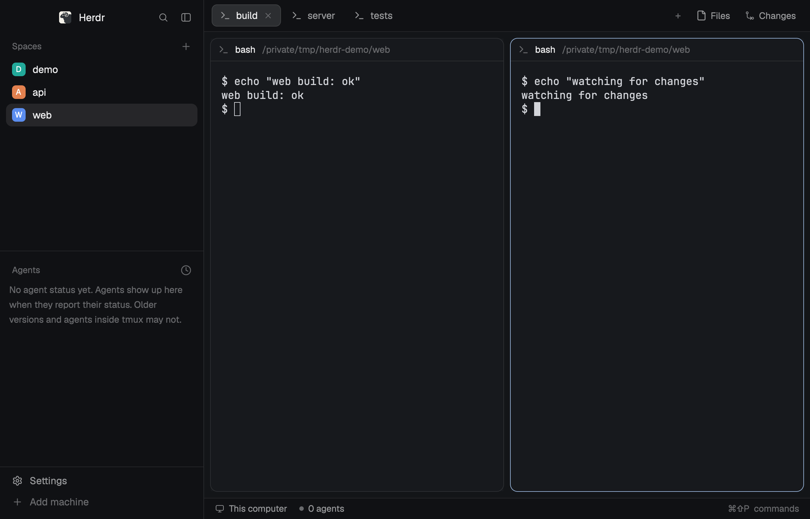

# Tab Drag

Herdr's `main` window with tabs and panes you can drag. A tab dragged along the bar moves to a new place. A tab dragged onto the pane area splits the shown tab with its terminal. A pane dragged up by its header to the tab bar gets a tab of its own.

## What you see

The window is Herdr's `main` layout at app version 0.1.16, with two blocks changed:

- **Sidebar**, 268px (min 44, max 480, `chrome` background, not resizable): `workspace-chrome` 46px, then `spaces` and `agents` (weight 1 each, min 90), then `workspace-chrome` with `props: { footer: true }` 69px.
- **Tab bar**, 42px, `window_drag: true`, mod `tabs-dnd`. It looks the same as Herdr's `tabs`: tabs 29px high, 10px side padding, 7px gap, 7px corners, 12.8px text, names at most 170px wide. The active tab has a `border` outline on `raised`. A `+`, then Files and Changes buttons, sit on the right.
- **Work body**, a row with 8px padding and 8px gap: the active tab, and a hidden 368px panel (min 280, max 900) that stacks `files` and `changes`.
- **Pane frames**: `background` fill, 1px `border` outline, 1px `accent` outline on focus, 10px corners, 8px gap, `lone: true`. Each pane has a 30px header at the top, mod `pane-dnd`, `reveal: "always"`.
- **Pane header**: 10px side padding, 8px gap, 12px text, a 1px `border` line under it. From left: the program icon (14px), the name (medium weight, at most 260px), the folder in `dim` with the home folder shown as `~`, and the status. On hover, four 14px buttons: split right, split down, zoom (or unzoom) and close.
- **Status bar**, 28px, `workspace-status`.

While you drag:

- **Tab reorder**: the dragged tab fades to 50%. A 2px `accent` line shows on the target tab, on its right edge when you move right and on its left edge when you move left.
- **Tab onto the pane area**: a full-window overlay (`tab-drop`) draws the layout's own tree, so the zones sit where the window has them. The half of the pane area nearest the pointer gets a 2px `accent` border, 10px corners and `accent` at 20% alpha (`33`).
- **Header onto the tab bar**: the same overlay. The tab bar gets a 2px `accent` border, 6px corners and the same 20% fill.

## How it behaves

- **Agent status** shows as in Herdr's own mods. On a tab: `working` is a 12px spinner (`working`, one turn per 900ms), `blocked` and `done` are a 6px dot in that color. On a pane header: `working` is the same spinner, `blocked` is a "Needs you" badge (18px high, 10.5px semibold, `blocked` text on `blocked` at 15% alpha), `done` is a 7px `done` dot. `idle` shows nothing.
- **Tab click** shows the tab. **Double-click** renames it (`tab.rename`). **Right-click** opens Herdr's `menu` for the tab. The wheel switches tabs. Each space remembers its open side panel.
- **Tab reorder**: press a tab, move over another tab and let go. This runs `tab.move { id, index }` with the target's one-based place.
- **Tab to split**: press a tab and leave the bar. `tabs-dnd` opens `tab-drop` as a popup with `frame: "none"`, `at: {x: 0, y: 0}`, `width: 1`, `height: 1`. The moving terminal is the dragged tab's focused pane, or its first pane. The target is the focused pane of the shown tab. If the dragged tab is the shown tab, nothing can drop and a release only ends the drag. Over the pane area, the nearest edge (left, right, top or bottom) picks the zone. Back over the tab bar, more than 4px above its bottom edge, the overlay closes and the drag goes on as a reorder.
- **The drop**: `tab-drop` runs `terminal.park` on the moving terminal and writes shared `tab-drop.move` as `{ terminal, place, swap, until }`. `place` is `right` for the left and right zones and `down` for the top and bottom zones. For left and top, `swap` is the target pane. `until` is now plus 5000ms.
- **Finishing the move**: `tabs-dnd` runs one step each time it draws. When the terminal has no pane, it runs `terminal.keep { terminal, place }` and marks the move `kept`. When the terminal has a pane again, it runs `pane.swap { pane, target: swap }` if `swap` is set, and clears the move. A move older than `until` is cleared.
- **Header drag**: press a pane header and leave it. If the pane has a terminal and its tab has two or more panes, `pane-dnd` opens `tab-drop` with `out: true`. The tab bar is then the only drop. A release there parks the terminal and writes `tab-drop.move` with `place: "tab"`.
- **Grip drag**: the app's own grip moves panes inside a tab. A release over the tab bar is a cancel to the app. `tabs-dnd` sees a mouse-up with no press in the bar, and then parks the focused terminal with `place: "tab"`. This happens only if the focused pane's tab has two or more panes and no move is running.
- A press anywhere on the overlay, or a release outside a zone, ends the drag with no change.

## Built from

- **Layout** `layouts/main-dnd.json`: Herdr's `main` 0.1.16 (`cloned_from: { name: "main", version: "0.1.16" }`). Root row, `titlebar: "none"`, `traffic_lights: [12, 16]`, `terminal_padding: [14, 12]`, `canvas` background, 1px `border` dividers. The `tabs` block has `content: { mod: "tabs-dnd" }`. The `main` block has `content: { tab: "active", pane: { header: { content: { mod: "pane-dnd" }, reveal: "always", height: 30, position: "top" }, ... } }`.
- **`mods/tabs-dnd`**: a `mod.clone` of the shipped `tabs` at 0.1.16. `mod.json`: `place: "none"`, `title: "Tabs"`, `cloned_from: { name: "tabs", version: "0.1.16" }`. Added: `drag()`, `step()`, the reorder fade and line, the bar's mouse-up for the grip, and a `nextCommand()` loop that takes `resume`. Window icons `win-close.svg`, `win-max.svg`, `win-min.svg`, `win-restore.svg` (Windows only).
- **`mods/pane-dnd`**: a `mod.clone` of the shipped `pane` at 0.1.16. `mod.json`: `place: "none"`, `title: "Pane header"`, `cloned_from: { name: "pane", version: "0.1.16" }`. Added: `drag()` and the header's mouse-down and mouse-up. Icons `close.svg`, `split-right.svg`, `split-down.svg`, `zoom.svg`, `unzoom.svg`.
- **`mods/tab-drop`**: new. `mod.json`: `place: "none"`, `title: "Tab drop zones"`. Props: `bar` (the tab bar's mod name), `terminal`, `target`, and `out`. It sets its height to `window.viewport_size().height / settings().zoom`.
- **herdr functions**: `spaces`, `panes`, `focused`, `run`, `openOverlay`, `closeOverlay`, `shared`, `setShared`, `layout`, `theme`, `settings`, `window`, `props`, `home`, `nextCommand`.
- **Commands**: `tab.move`, `tab.select`, `tab.rename`, `tab.close`, `terminal.park`, `terminal.keep`, `pane.swap`, `pane.focus`, `pane.split`, `pane.zoom`, `pane.close`, and the panel commands `layout.select`, `layout.show`, `layout.hide`.
- **Shipped art and mods used**: `mods/pane/close.svg`, `mods/workspace-chrome/spinner.svg`, `mods/files/file.svg`, `mods/changes/changes.svg`, and the `menu` and `new-menu` overlays.
- No programs, no files, no network.

## Watch out

- Mods get no drag and drop events. A drag here is a press on one element and a release on another. A press that leaves its element (`on_hover(false)` while pressed) opens the overlay. The overlay then gets the release.
- The overlay is only as tall as its content. Set its height from the viewport, divided by the zoom, or the lower half of the window has no zones.
- Relabeling or keeping a terminal that still has a pane does nothing. Park first, then wait until `panes()` no longer lists the terminal, then `terminal.keep`. `terminal.keep` only places right of or under the focused pane, so left and top need a `pane.swap` after it.
- `tabs-dnd` finishes moves from its render, so the move needs the tab bar on screen.
- The app does not tell mods which pane its grip carries. The grip fallback moves the focused pane. A text selection released on the bar triggers it too. No highlight shows during a grip drag.
- The names are fixed in the code: `bar: "tabs-dnd"` in `tabs-dnd` and `pane-dnd`, the command `tabs-dnd.resume`, the icon paths `mods/tabs-dnd/` and `mods/pane-dnd/`, and the shared key `tab-drop.move`. A rename must change all of them.
- `tabs-dnd` and `pane-dnd` stay at 0.1.16. They miss later changes to the shipped `tabs` and `pane`.

## Done when

- `herdr-app check` passes for `mods/tabs-dnd`, `mods/tab-drop` and `mods/pane-dnd`.
- `herdr-app do layout.switch --name main-dnd` shows the window, and `herdr-app status` shows `errors: []`.
- A tab pressed and released on another tab moves there, and `herdr-app ls` shows the new order.
- A tab that is not shown, dropped on the right half of the pane area, appears as a pane right of the focused pane. Dropped on the left half, it appears left of it.
- In a tab with two panes, a pane header dragged to the tab bar becomes a new tab, and the old tab keeps one pane.
- A header drag that ends outside the tab bar changes nothing.
