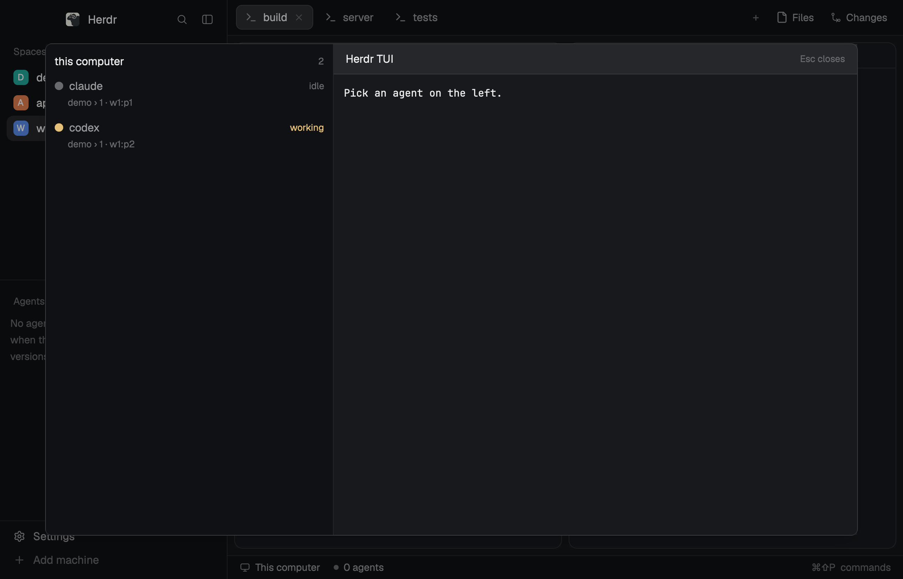

# TUI Bridge

See and prompt the agents that still run in the herdr terminal app (the TUI), from inside the [Herdr](https://herdr.dev) desktop app. The bridge lists the agents on this computer and on every machine saved in `herdr machine list`. Pick one to read its screen. Type a prompt and press Enter to send it.



The preview shows demo agents on a test herdr server.

The entry is one mod, `mods/herdr-tui`. It opens as a dialog, 90% of the window wide and 85% high.

**Before you add it:** the mod runs the `herdr` program. Through `herdr --machine`, it reaches every enabled machine saved in `herdr machine list`. It reads agent screens and sends prompts. It does not close, move or start anything.

## Add it

Ask your Herdr agent:

```text
Read ~/.config/herdr-app/AGENTS.md, then add this mod: herdr.dev/mods/Dot-Fun/herdr-mods/tui-bridge
```

To add it by hand:

1. Clone the repository: `git clone https://github.com/Dot-Fun/herdr-mods.git`.
2. Copy the mod: `cp -R herdr-mods/tui-bridge/mods/herdr-tui ~/.config/herdr-app/mods/`.
3. Check it: `herdr-app check ~/.config/herdr-app/mods/herdr-tui`.
4. Open it: `herdr-app do mod.open --name herdr-tui`.

The mod has no key of its own. To open it with a key, add one to the `global` section of `~/.config/herdr-app/keys.json`, for example `"cmd-shift-u": "mod.open:herdr-tui"`. The [prefix-keys](../prefix-keys/README.md) entry opens it with `ctrl-b t`.

## Use

| Action | What happens |
| --- | --- |
| Open the bridge | The left column lists each machine and its agents. |
| Click an agent | The right side shows that agent's screen. The prompt field takes the keyboard. |
| Type and press Enter | The text goes to the agent as one prompt. The field clears when it is sent. |
| Press Escape | The dialog closes. |

Each agent row shows a status dot, the agent kind, its title and its status. The second line shows `space › tab · pane id` in the TUI.

Each machine header shows the agent count. It shows `…` while it loads and `unreachable` when `herdr` fails for it, with the error under it.

The note beside the prompt field shows `sending…`, `sent`, `send failed: <error>` or `send unconfirmed: <error>`. "Unconfirmed" means the send timed out. The prompt may still have arrived, so read the screen before you send again.

## Known limits

- The `herdr` TUI program must be on the PATH that the app sees. The app takes its PATH from your login shell.
- The bridge polls. It reloads the agent list every 15 seconds and the selected agent's screen every 3 seconds. A change in the TUI can take that long to show.
- It can read a pane and send a prompt, nothing else. It does not answer questions, press keys, close agents or switch tabs in the TUI.
- It lists only machines that are enabled in `herdr machine list`. A slow or offline machine shows `…` or `unreachable`, and the others still load.
- Each `herdr` call times out after 8 seconds. A send times out after 20 seconds.
- The screen is plain text, with no colors.

## License

Apache License 2.0. See [LICENSE](../LICENSE).
