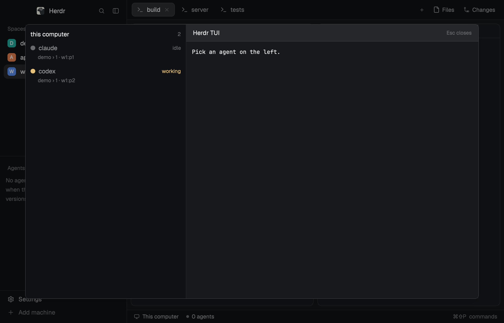

# TUI Bridge

A dialog that shows the agents in the herdr TUI, on this computer and on every enabled machine in `herdr machine list`. The person picks an agent to read its screen, and types a prompt to send it. The prompt is the only write.

## What you see

A dialog overlay, 0.9 of the window wide and 0.85 high, on `popover` with `foreground` 13px text. It is a row of two parts.

- **Left column**, 340px, `chrome` background, 1px `border` line on its right, scrolls up and down. One block per machine, this computer first:
  - **Machine header**: the label (`this computer` for the local one) in semibold, `foreground`, or `dim` when it failed. On the right, in 11px: the agent count in `dim`, `…` while loading, or `unreachable` in `blocked`.
  - **Error line**, only when it failed: the last line of the error, 11px `dim`, one line.
  - **Agent rows**, 10px side padding, 6px corners, `hover` on hover, `selected` when chosen. First line: a `●` in the status color, the agent kind in `muted`, the title in `foreground` (cut to one line), and the status word in 11px in the status color. Second line, 11px `dim`, 16px in: `<space> › <tab> · <pane id>`.
- **Right side**, the rest of the width:
  - **Header**, 36px, a 1px `border` line under it. Left, semibold: `Herdr TUI`, or `<machine> · <title>` once an agent is chosen. Right, 11px `dim`: `Esc closes`, or the pane id.
  - **Screen**, `background`, 12px padding, scrolls both ways. The agent's visible screen as plain lines in the person's terminal font (`settings().font_family`, else `JetBrains Mono`), 12px. Before a choice it shows `Pick an agent on the left.`, and `reading…` until the first read returns.
  - **Prompt row**, only once an agent is chosen: 10px padding, a 1px `border` line above it. A text field 34px high with 8px corners, an `input` border and the placeholder `Prompt for the selected agent. Enter sends.`. Beside it, a note of at most 320px in 11px: `dim`, or `blocked` when it says failed or unconfirmed.

## How it behaves

- **Status**: the dot and word use the theme color named by the agent's status (`working`, `blocked`, `done`, `idle`), or `unknown` for any other value. A missing status shows as `unknown`.
- **Agent list**: on open and every 15000ms. It runs `herdr machine list --json` and keeps the labels with `enabled: true`. Then it runs `herdr api snapshot` for this computer and `herdr --machine <label> api snapshot` for each label, all at once. Each machine block updates when its own answer arrives. A list load does not start while one is still running.
- **Agent fields** from the snapshot: `pane_id`, `agent` (else `agent`), `agent_status` (else `unknown`), title from `name`, else `terminal_title_stripped`. The space and tab names come from the snapshot's `workspaces` and `tabs` labels.
- **Click an agent**: it becomes the choice, the screen clears and is read at once, and the prompt field takes focus.
- **Screen**: every 3000ms for the chosen agent, `herdr [--machine <label>] agent read <pane> --source visible`. Trailing blank space is cut. A failed read shows `read failed: <last line>`.
- **Enter in the field**: if the text is not empty and no send is running, it runs `herdr [--machine <label>] agent prompt <pane> <text>`. The note shows `sending…`, then `sent` (the field clears), `send failed: <last line>`, or `send unconfirmed: <last line>` when the call throws, such as on a timeout. The screen is read again after each send.
- **Escape** closes the dialog, as for any dialog overlay.

## Built from

- **Mod** `mods/herdr-tui`: one View. `mod.json`: `{ "place": "none", "title": "Herdr TUI", "overlay": { "kind": "dialog", "width": 0.9, "height": 0.85 } }`. It opens with `mod.open {name: "herdr-tui"}`.
- **gpui-base**: `v_flex`, `h_flex`, `InputState`, `Input`. The field's `submit` event sends.
- **herdr functions**: `exec`, `theme`, `settings`, `checking`.
- **Program**: `herdr`, the TUI's CLI: `machine list --json`, `api snapshot`, `agent read <pane> --source visible`, `agent prompt <pane> <text>`, each with `--machine <label>` for another machine.
- **Timings**: list 15000ms, screen 3000ms, query timeout 8000ms, send timeout 20000ms.
- No art. No layout. No keys.

## Watch out

- Agents are addressed by pane id (`w1:p2`), because most have no herdr agent name.
- Guard the timers and first load with `checking()`. `herdr-app check` runs `init()` for real, and it would run `herdr` otherwise.
- A machine that hangs must not hold up the others. Load each machine in its own task and redraw as each one answers.
- A send that times out may still have reached the agent. Say "unconfirmed", not "failed", and read the screen again.
- `exec("herdr", ...)` needs `herdr` on the PATH the app sees. The app takes its PATH from the login shell.
- The screen is plain text. Colors and cursor are lost.

## Done when

- `herdr-app check mods/herdr-tui` passes.
- `herdr-app do mod.open --name herdr-tui` opens the dialog, and the left column lists this computer with the same agents as `herdr api snapshot`.
- Each enabled machine from `herdr machine list` has a block. A machine that is off shows `unreachable` and its error, and the others still list.
- A click on an agent shows the same text as `herdr agent read <pane> --source visible`, and it changes within 3 seconds when the agent's screen changes.
- Text typed in the field with Enter reaches that agent, and the note shows `sent`.
